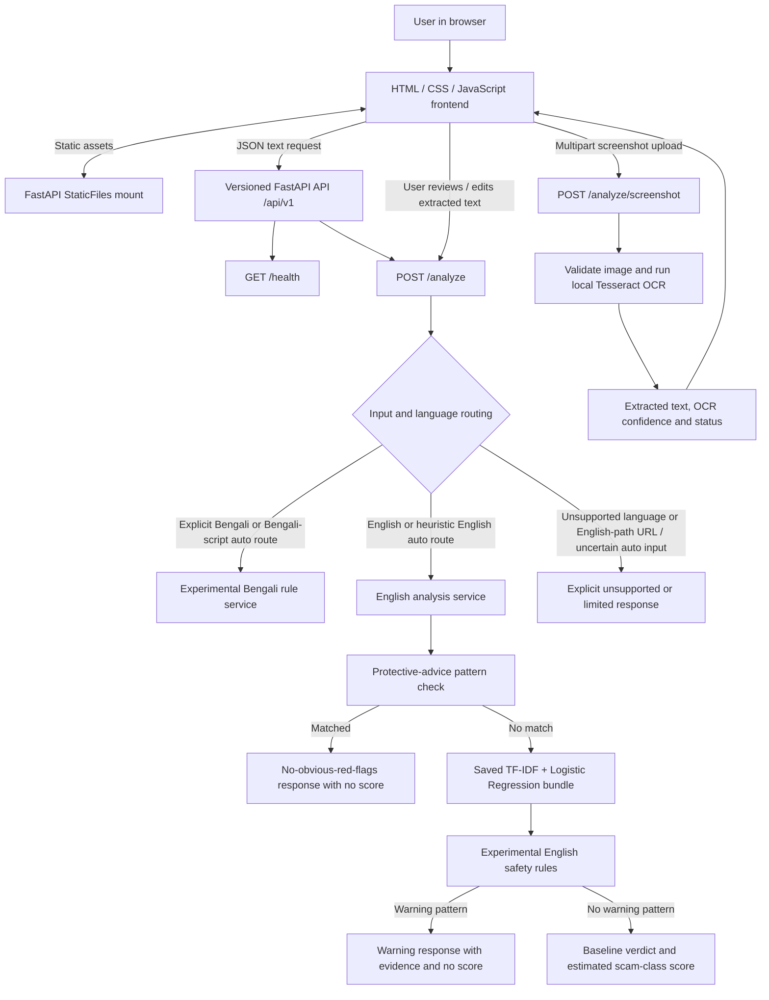
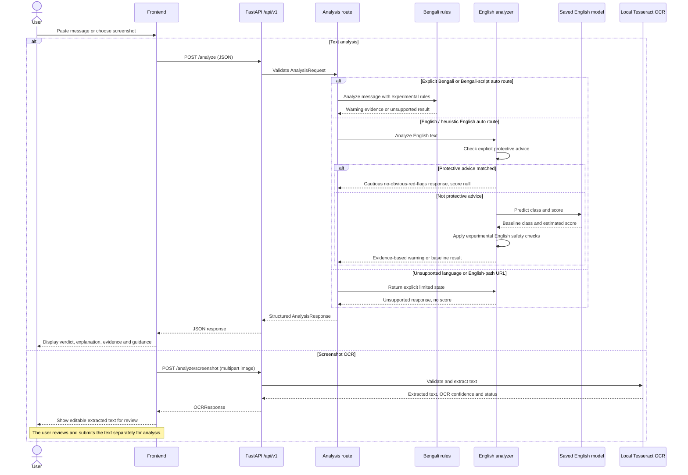

# Sotorko Technical Design Document

**Project:** Sotorko (সতর্ক) — A Bengali-First Scam Checker  
**Team:** CyberHead  
**Document status:** Describes the current prototype implementation and explicitly separates it from planned work.

## 1. Purpose and scope

Sotorko is a digital-safety prototype that helps users inspect suspicious message text and screenshot text. The current implementation combines an English TF-IDF + Logistic Regression baseline, selected experimental English safety checks, experimental Bengali rule-based signals, and local OCR for screenshot text extraction.

This document describes what the repository implements today. It is not a claim that all planned languages or product features are supported.

### Current scope

- A browser-based frontend served by FastAPI.
- Versioned REST endpoints under `/api/v1`.
- Pydantic request and response validation.
- English message analysis through a saved model artifact and a separate experimental safety-rule check.
- Experimental Bengali warning rules without a calibrated risk score.
- Screenshot OCR that extracts text for the user to review.
- Automated regression, endpoint, OCR, frontend, and data-validation tests.

### Out of scope for this prototype

- A trained, independently evaluated Bengali, Banglish, or Hindi classifier.
- URL reputation or URL-content analysis.
- Database persistence, user accounts, authentication, or authorization.
- Voice interfaces, automatic external reporting, and third-party service integrations.
- A production guarantee that a message is safe or fraudulent.

## 2. High-level architecture



### Component responsibilities

| Component | Responsibility |
|---|---|
| `app/main.py` | Creates the FastAPI application, registers the versioned API router, and serves the frontend. |
| `app/api/v1/router.py` | Groups API routes under the configured `/api/v1` prefix. |
| `app/api/v1/health.py` | Exposes a simple health endpoint. |
| `app/api/v1/analyze.py` | Accepts analysis requests, applies conservative language routing, and exposes screenshot OCR. |
| `app/schemas/analysis.py` | Defines Pydantic input/output models and enum values for input types, languages, statuses, verdicts, categories, and evidence flags. |
| `app/services/analyzer.py` | Loads and caches the saved English model bundle, evaluates English text, handles limited states, and returns structured analysis results. |
| `app/services/english_safety.py` | Detects selected English credential, urgency/threat, and payment-related warning patterns. These checks are experimental. |
| `app/services/bengali.py` | Applies selected Bengali rules and produces evidence-backed warnings or an unsupported/inconclusive result. |
| `app/services/language.py` | Uses conservative script/content heuristics for limited automatic routing; it is not a general multilingual language-identification model. |
| `app/services/ocr.py` | Validates image uploads, prepares the image, invokes local Tesseract, and returns extracted text and OCR metadata. |
| `frontend/` | Provides the user interface, language toggle, message-entry workflow, screenshot upload/review, and result display. |
| `data/derived/ml_baseline/` | Stores the saved English model bundle used by the live English baseline. |
| `tests/` | Exercises analysis behavior, endpoint health, OCR, frontend behavior, backend reliability, fixtures, and data validation. |

## 3. Request and decision flow



### Text analysis routing

1. The request is validated against `AnalysisRequest`.
2. For text with `language=auto`, a substantial Bengali-script signal routes to the experimental Bengali service. A conservative English heuristic can route likely English prose to the English service.
3. Explicit Bengali text is sent to the experimental Bengali service.
4. English text first checks a narrow protective-advice pattern. If that pattern matches, the service returns a cautious no-obvious-red-flags result with no numerical score and an explicit caveat.
5. Otherwise the English service loads the model bundle (cached per process), obtains the model prediction and estimated scam-class score, and runs the experimental English safety checks. When those checks match, the response is marked suspicious and no numerical score is returned for that rule-based result.
6. Hindi, Banglish, English-path URL input, and uncertain auto-routed inputs do not receive a reliable supported classification from the main service. Their response must not be treated as a safe verdict.
7. Implementation caveat: an explicitly Bengali request is currently routed to the Bengali text rules even if its `input_type` is `url`. This only applies text-pattern checks to the submitted content; it is not dedicated URL analysis and must not be presented as URL support.
8. The frontend displays the result, evidence when available, and safety guidance.

A “no rule matched” or “no obvious red flags” result does not prove safety. The English model score is not a guarantee of safety or fraud, and the Bengali rules do not output a calibrated risk score.

## 4. Screenshot OCR flow and limits

The endpoint `POST /api/v1/analyze/screenshot` accepts a multipart image and returns extracted text for user review. It is deliberately separate from text classification: the user reviews or edits the OCR output and submits that text through `POST /api/v1/analyze` as a separate action.

The OCR service currently enforces:

- Allowed content types: PNG, JPEG, and WebP.
- Maximum input size: 8 MiB.
- Maximum width and height: 6000 × 6000 pixels each.
- Maximum pixel count: 20,000,000 pixels.
- A 20-second Tesseract timeout.

OCR depends on the Python packages `Pillow` and `pytesseract`, a local Tesseract executable, and the required language data. The development setup uses `eng` and `ben` language data for English and Bengali OCR. OCR confidence describes text extraction quality only; it is not a scam score. The current OCR implementation processes the image in memory and does not persist the uploaded screenshot.

## 5. API contract

The API is versioned under `/api/v1`.

| Method | Endpoint | Input | Purpose |
|---|---|---|---|
| `GET` | `/api/v1/health` | None | Returns a simple service-health status. |
| `POST` | `/api/v1/analyze` | JSON `AnalysisRequest` | Analyzes text where supported and returns `AnalysisResponse`. |
| `POST` | `/api/v1/analyze/screenshot` | Multipart image and optional language | Extracts screenshot text and returns `OCRResponse`. |

### Text request fields

- `input_type`: `text` or `url`. URL analysis is not implemented by the current text model.
- `content`: non-empty submitted text.
- `language`: `auto`, `bn`, `hi`, `en`, or `banglish`. Enumerated values are accepted by the schema, but the presence of a value does not imply that a reliable classifier is available.
- `incident_status`: `unknown`, `not_lost`, or `lost_money`.

### Analysis response fields

The response schema includes:

- `status`: for example, `predicted`, `unsupported`, `unavailable`, or `failed`.
- `verdict`: for example, `suspicious`, `likely_scam`, `no_obvious_red_flags`, or `unsupported`.
- `risk_score`: optional numeric score; intentionally absent for experimental rule-based warning responses and unsupported results.
- `detected_language` and `output_language`.
- `scam_category`, `red_flags`, `evidence`, `explanation`, and `safety_guidance`.
- `recommended_actions` and a reporting placeholder; external reporting is not implemented.

The exact enum values and field constraints are defined in `app/schemas/analysis.py`.

## 6. Model artifact and configuration

The English analyzer loads a saved model bundle containing the feature transformer and classifier. The bundle is cached after loading to avoid reloading it for each request.

Default model path:

```text
data/derived/ml_baseline/tfidf_logistic_regression.joblib
```

Optional environment variables read by the current services:

| Variable | Purpose | Default behavior |
|---|---|---|
| `SOTORKO_MODEL_PATH` | Overrides the path to the English model bundle. | Uses the bundled artifact path above. |
| `SOTORKO_TESSERACT_CMD` | Allows an explicit path to the Tesseract executable. | Attempts to use Tesseract available on `PATH`, with fallback checks for common Windows locations. |

No database connection, API key, or `.env` file is required by the current prototype. The model artifact must be trusted; do not load an untrusted joblib/pickle file.

## 7. Data, evaluation and testing

### Sample and evaluation data

- `data/samples/sample_messages.json`: schema-level examples marked as synthetic.
- `tests/fixtures/multilingual_smoke_cases.json`: 32 synthetic cases across Bengali, Banglish, Hindi, and English, balanced between scam and genuine labels.
- `docs/dataset.md`, `docs/data-sources.md`, and related data audit notes: dataset schema, source provenance, and limitations.

The smoke evaluation is a diagnostic of current implementation behavior, not a representative benchmark. It must not be used to claim real-world precision, recall, or accuracy. Unsupported outputs count as abstentions, not successful scam detection or safe-message identification.

### Run tests locally

With dependencies installed and from the repository root:

```powershell
python -m pytest -q --basetemp "$PWD\.pytest-tmp-run"
```

Run the smoke evaluation:

```powershell
python scripts/evaluate_multilingual.py
```

The GitHub Actions workflows run the health endpoint contract and regression suite. A passing test suite only verifies the behaviors covered by the tests; it does not prove real-world detection quality.

## 8. Security, privacy and operational considerations

- Do not use Sotorko as the sole basis for a financial, identity, or account-security decision.
- Users should never paste real passwords, PINs, or live OTPs into sample data or test fixtures.
- Verify suspicious requests using an independent official channel; avoid clicking links or making payments based only on a message.
- Screenshot OCR currently processes uploads in memory and does not persist the screenshot in the application. This does not imply that other hosting infrastructure or reverse proxies have no logs.
- The prototype does not implement user authentication, access control, database-backed audit trails, rate limiting, or external incident reporting.
- Before public deployment, add deployment-specific controls such as HTTPS, suitable request limits, monitoring, dependency/version management, and a privacy review.
- Experimental rule checks can miss fraud or flag legitimate messages. Text extracted by OCR can contain recognition errors and must be reviewed.

## 9. Known limitations and future work

1. Build and independently evaluate Bengali classification with human-verified scam and genuine messages.
2. Add Banglish and Hindi support only after suitable annotated data, evaluation, and regression tests are available.
3. Improve the English baseline's false-positive and missed-scam behavior on an independent, representative evaluation set.
4. Add URL analysis only with a defined, safely tested URL-analysis design.
5. Consider privacy-preserving storage, consent, authentication, and incident-reporting integrations if product requirements justify them.
6. Expand evaluation with consented or appropriately licensed data, fluent-speaker review, provenance, de-duplication, and a held-out test set.

## 10. Related documentation

- [Project README](../README.md)
- [Dataset specification](dataset.md)
- [Dataset sources](data-sources.md)
- [Multilingual smoke evaluation](multilingual-evaluation.md)
- [Data ingestion tooling](../scripts/data/README.md)

---

**Maintainer:** Team CyberHead  
**Project:** Sotorko (সতর্ক) — A Bengali-First Scam Checker
